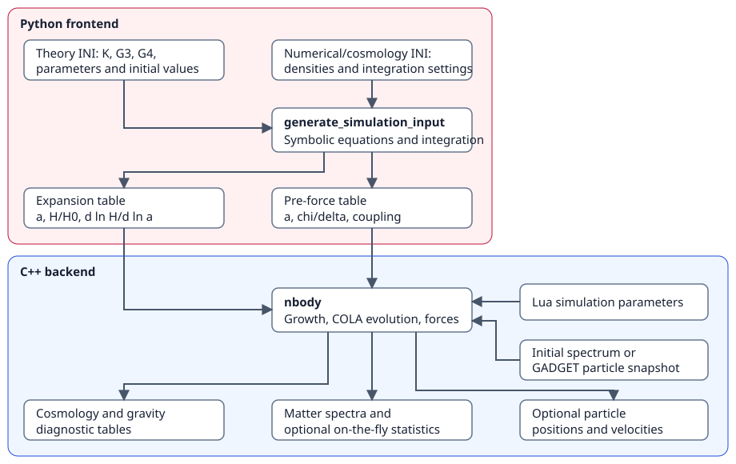

# Theory and code structure

[Documentation home](index.md) · [Background equations](equations.md) · [References](references.md)

## Purpose and scope

Hi-COLA is designed for rapid exploration of how gravity models affect nonlinear large-scale structure. A model is supplied as a Lagrangian rather than selected from a fixed menu. The frontend constructs the background equations symbolically, then the backend uses the resulting expansion and fifth-force tables in a COmoving Lagrangian Acceleration (COLA) simulation.

The parent theory is reduced Horndeski gravity: scalar-tensor theories with gravitational waves travelling at the speed of light. The native approximate force prescription uses Vainshtein screening. The existence of other hard-coded FML gravity models does not make the generic Hi-COLA prescription a general chameleon-screening solver. K-mouflage applications require model-specific settings and validation; see the [research papers](references.md).

## Inputs, computation, and outputs

| Stage | Inputs | Computation | Outputs |
| --- | --- | --- | --- |
| Frontend | Theory INI and numerical/cosmology INI | Symbolic equations, closure root, background integration | Expansion and pre-force tables |
| Backend | Lua parameters, both tables, and an initial spectrum or GADGET snapshot | Growth factors, initial conditions, COLA particle evolution, approximate screened forces | Cosmology and growth diagnostics, spectra, optional snapshots and halo statistics |

The frontend and backend are run separately. A frontend background calculation can also be used on its own to check expansion histories before committing to a simulation. Its theory functions are `K(phi, X)`, `G3(phi, X)`, and `G4(phi)`; specifying arbitrary `X` dependence in `G4` goes beyond the reduced class described here.

The corresponding files are:

- [Expression builder](repo:HiCOLA/Frontend/expression_builder.py): symbolic equations and numerical callbacks.
- [Numerical solver](repo:HiCOLA/Frontend/numerical_solver.py): closure and background evolution.
- [Generator](repo:HiCOLA/Frontend/generate_simulation_input.py): export of the tables used by the backend.
- [Hi-COLA cosmology](repo:HiCOLA/FML/COLASolver/src/Cosmology_HiCOLA.h): splines the expansion table.
- [Hi-COLA gravity model](repo:HiCOLA/FML/COLASolver/src/GravityModel_HiCOLA.h): splines coupling/screening inputs and computes the extra force.
- [Backend entry point](repo:HiCOLA/FML/COLASolver/src/Main.cpp) and [COLA machinery](repo:HiCOLA/FML/COLASolver/src/COLA.h): initialise the models and evolve the simulation.

## Three ingredients for modified-gravity COLA

1. **Expansion:** the frontend supplies $E(a)=H(a)/H_0$ and $d\ln H/d\ln a$.
2. **Forces:** background coupling and screening quantities are combined with the density field reconstructed from particles.
3. **Growth:** the backend solves the Lagrangian perturbation theory (LPT) growth equations used in the COLA trajectories.

In the presentation paper's convention, the total force is

$$
F_{\mathrm{tot}}=F_N\frac{G_{G_4}}{G_N}\,[1+\beta(a)\,\mathcal S(\chi)],
\qquad
\mathcal S(\chi)=\frac{2}{\chi}\left(\sqrt{1+\chi}-1\right).
$$

$G_{G_4}$ denotes the gravitational normalisation associated with the $G_4$ sector. The pre-force table provides $\beta$ and $\chi/\delta_m$, while the simulation supplies the local density perturbation $\delta_m$. The continuous small-$\chi$ limit is $\mathcal S\to1$. The precise smoothing, low-density treatment, and large-scale blending used in a run are implemented by the backend; see [screening settings](backend.md#screening) rather than applying this schematic expression as a replacement force solver.

## Growth factors and the approximation

With primes denoting derivatives with respect to $x=\ln a$, the scale-independent, pressureless-matter equations described in the original manual are

$$
D_1''=\frac{3\Omega_{m0}}{2E^2a^3}\frac{G_{\mathrm{eff}}}{G_N}D_1
-\left(2+\frac{E'}E\right)D_1',
$$

$$
D_2''=\frac{3\Omega_{m0}}{2E^2a^3}\frac{G_{\mathrm{eff}}}{G_N}
\left(D_2-D_1^2\right)
-\left(2+\frac{E'}E\right)D_2'.
$$

For the current Hi-COLA class, $G_{\mathrm{eff}}/G_N=1+\beta(a)$. The displayed $D_2$ equation uses the linear effective coupling and does not include the full leading screening correction to second-order growth. The particle force calculation does include the approximate screening prescription. The original validation found this growth approximation subdominant for its tested models and parameter choices; it is not an accuracy guarantee for every new model.

See the [accuracy guide](resolution.md) for convergence choices and the [equation reference](equations.md) for frontend normalisation and closure.
