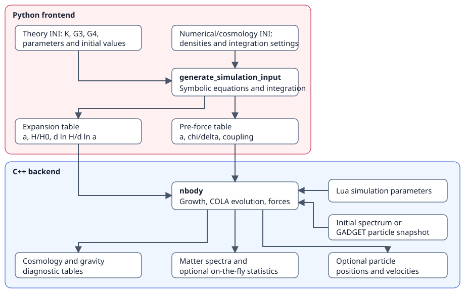

# Theory

Hi-COLA explores how gravity models affect nonlinear structure. A model is given as a Lagrangian in reduced Horndeski gravity (scalar-tensor theories whose gravitational waves travel at the speed of light). The frontend builds and solves its background equations; the backend uses the resulting tables in a COmoving Lagrangian Acceleration (COLA) simulation with approximate Vainshtein screening. K-mouflage needs model-specific settings; the generic prescription is not a chameleon solver.

| Stage | Code | Role |
| --- | --- | --- |
| Frontend | [expression_builder.py](repo:HiCOLA/Frontend/expression_builder.py), [numerical_solver.py](repo:HiCOLA/Frontend/numerical_solver.py), [generate_simulation_input.py](repo:HiCOLA/Frontend/generate_simulation_input.py) | Symbolic equations, closure, background integration, table export. |
| Backend | [Cosmology_HiCOLA.h](repo:HiCOLA/FML/COLASolver/src/Cosmology_HiCOLA.h), [GravityModel_HiCOLA.h](repo:HiCOLA/FML/COLASolver/src/GravityModel_HiCOLA.h), [COLA.h](repo:HiCOLA/FML/COLASolver/src/COLA.h) | Spline the tables, compute growth and forces, evolve particles. |

Notation: $K_X=\partial K/\partial X$, and primes denote $d/dx$ with $x=\ln a$. The theory functions are $K(\phi,X)$, $G_3(\phi,X)$, and $G_4(\phi)$.

## Force and growth

The total force on a particle is

$$
F_{\mathrm{tot}}=F_N\frac{G_{G_4}}{G_N}\,[1+\beta(a)\,\mathcal S(\chi)],
\qquad
\mathcal S(\chi)=\frac{2}{\chi}\left(\sqrt{1+\chi}-1\right),
$$

with $\mathcal S\to1$ for small $\chi$. The force table supplies $G_{G_4}/G_N$, $\beta$, and $\chi/\delta_m$, computed from the background as

$$
\beta=-(\alpha_1+\alpha_2)\mathcal C,\qquad
\frac{\chi}{\delta_m}=\frac{\mathcal B\mathcal C\,\Omega_{m0}}{E^2a^3},
$$

and the simulation supplies the local density contrast $\delta_m$. Smoothing and large-scale blending are set by the [screening options](backend.md#screening). The LPT growth factors obey

$$
D_1''=\frac{3\Omega_{m0}}{2E^2a^3}\frac{G_{\mathrm{eff}}}{G_N}D_1-\left(2+\frac{E'}E\right)D_1',
\qquad
D_2''=\frac{3\Omega_{m0}}{2E^2a^3}\frac{G_{\mathrm{eff}}}{G_N}\left(D_2-D_1^2\right)-\left(2+\frac{E'}E\right)D_2',
$$

with $G_{\mathrm{eff}}/G_N=1+\beta(a)$. $D_2$ omits the screening correction to second-order growth, which the original validation found subdominant for its models; particle forces include screening. Section 3.1 of the [presentation paper](references.md#citation) gives the derivation.

## Dimensions and mass ratios

In geometric units $c=\hbar=1$, the dimensionful action is

$$
S=\int d^4x\,\sqrt{-g}\left[
\widetilde G_4(\widetilde\phi)R
+\widetilde K(\widetilde\phi,\widetilde X)
-\widetilde G_3(\widetilde\phi,\widetilde X)\Box\widetilde\phi
-M_P^2\Lambda+\mathcal L_m\right],
$$

where $\widetilde X=-g^{\mu\nu}\partial_\mu\widetilde\phi\,\partial_\nu\widetilde\phi/2$ and, on a homogeneous background, $\widetilde X=\dot{\widetilde\phi}^{\,2}/2$.

| Quantity | Mass dimension |
| --- | --- |
| $\widetilde\phi$ | $M$ |
| $\widetilde X$, $\widetilde K$ | $M^4$ |
| $\widetilde G_3$ | $M$ |
| $\widetilde G_4$ | $M^2$ |
| $H$, $\partial_t$ | $M$ |

Write $\widetilde\phi=M_s\phi$, $H=H_0E$, and choose constant function normalisations $C_K$, $C_3$, and $C_4$ such that

$$
\widetilde K=C_KK,\qquad \widetilde G_3=C_3G_3,\qquad
\widetilde G_4=C_4G_4.
$$

The manual's function normalisations include $C_K=M_K^2H_0^2$, $C_3=M_{G_3}$, and $C_4=M_{G_4}^2$. A convention using $C_K=\widehat M_K^4$ is an equivalent way to specify a constant with mass dimension four, provided all coefficients are transformed consistently.

Because $d/dt=H\,d/dx$,

$$
\widetilde X=M_s^2H_0^2X,\qquad X=\frac{E^2}{2}(\phi')^2.
$$

For any function $\widetilde F=C_FF$, define $C_X=M_s^2H_0^2$. Derivative conversions follow the chain rule:

$$
F_X=\frac{C_X}{C_F}\widetilde F_{\widetilde X},\quad
F_\phi=\frac{M_s}{C_F}\widetilde F_{\widetilde\phi},\quad
F_{XX}=\frac{C_X^2}{C_F}\widetilde F_{\widetilde X\widetilde X},
$$

$$
F_{X\phi}=\frac{C_XM_s}{C_F}\widetilde F_{\widetilde X\widetilde\phi},\qquad
F_{\phi\phi}=\frac{M_s^2}{C_F}\widetilde F_{\widetilde\phi\widetilde\phi}.
$$

These identities cover the derivative conversions for $K$, $G_3$, and $G_4$ without mixing the two $K$ normalisation conventions. In the reduced theory $G_4$ depends only on $\phi$.

The frontend accepts the seven ratios `M_pG4`, `M_KG4`, `M_G3s`, `M_sG4`, `M_G3G4`, `M_Ks`, and `M_gp`. The notation $M_{ab}$ means $M_a/M_b$; for example `M_pG4` is $M_P/M_{G_4}$. `M_gp` is carried in the input list but is not used by the current `create_Horndeski` expressions. Their default is one. Non-unit choices require consistent dimensional conventions across the theory, initial conditions, and callbacks; see the [frontend reference](frontend.md#theory-file).

For clarity, the background formulas below use **all mass ratios equal to one**, the supplied examples' default. The [expression-builder API](api/index.rst) and its source retain the ratio factors for the general case. These formulas do not describe a second, separately validated implementation of the equations.

## Closure and scalar density

The non-dynamical Friedmann constraint is

$$
1=\Omega_m+\Omega_r+\Omega_\phi+\Omega_\Lambda,
$$

with the unit-ratio expression

$$
\begin{aligned}
\Omega_\phi={}&(\Omega_m+\Omega_r+\Omega_\Lambda)
\left(\frac{1}{2G_4}-1\right)\\
&+\frac{1}{3G_4}\left[
\frac{XK_X}{E^2}-\frac{K}{2E^2}
+3X\phi'G_{3X}-\frac{XG_{3\phi}}{E^2}-3\phi'G_{4\phi}
\right].
\end{aligned}
$$

The frontend solves this constraint for a selected initial value or model parameter. It is encoded by `omega_phi` and `fried_closure`; the latter returns the constraint residual after substituting $X=E^2(\phi')^2/2$.

## Dynamical equations

Define the auxiliary functions appearing in `EprimeEODERHS` and `phiprimeprimeODERHS`:

$$
\begin{aligned}
A={}&K_X-G_{3\phi}+2XG_{3\phi X}\\
&+6E^2\phi'(G_{3X}+XG_{3XX})
+E^2(\phi')^2(K_{XX}-2G_{3\phi X}),
\end{aligned}
$$

$$
B_1=6XG_{3X}-6G_{4\phi},
$$

$$
\begin{aligned}
B_2={}&3\phi'(K_X-2G_{3\phi}+2XG_{3\phi X})
+(\phi')^2(K_{X\phi}-2G_{3\phi\phi})-\frac{K_\phi}{E^2}\\
&-12G_{4\phi}+18XG_{3X}+\frac{2XG_{3\phi\phi}}{E^2}.
\end{aligned}
$$

Writing $q=E'/E$, the current builder's unit-ratio algebra is

$$
q=\frac{
-\dfrac{K-2XG_{3\phi}+4XG_{4\phi\phi}}{4G_4E^2}
-\dfrac{G_{4\phi}\phi'}{G_4}
-\dfrac12\left[\dfrac{\Omega_r-3\Omega_\Lambda}{2G_4}+3\right]
+\dfrac{(G_{4\phi}-XG_{3X})B_2}{2G_4A}
}{1+\dfrac{(XG_{3X}-G_{4\phi})B_1}{2G_4A}},
$$

$$
\phi''=-\frac{B_1q+B_2}{A}-q\phi'.
$$

Matter and radiation obey

$$
\Omega_m'=-\Omega_m(3+2q),\qquad
\Omega_r'=-\Omega_r(4+2q).
$$

For a constant cosmological constant, $\Omega_\Lambda\propto E^{-2}$ and therefore $\Omega_\Lambda'=-2q\Omega_\Lambda$ when $E$ is the physical $H/H_0$.

The numerical solver integrates in $\ln a$ using `solve_ivp` with RK45. Small values of $A$ enter the solver's threshold handling; consult the API and validate convergence rather than assuming the threshold produces a physical solution at a singularity. The current `G3_func` `phi` selector has a known derivative defect, so explicitly $\phi$-dependent $G_3$ models need independent validation before these nominal derivative expressions can be treated as the computed solution.

## Initial conditions and rescaling

In an unrescaled model, present-day $E_0=1$ by definition. The remaining background initial values include $\phi'_0$, $\Omega_{m0}$, $\Omega_{r0}$, and the model's constants; closure removes one free choice. The scalar fraction sets

$$
\Omega_{\mathrm{DE},0}=1-\Omega_{m0}-\Omega_{r0},\qquad
\Omega_{\Lambda0}=(1-f_\phi)\Omega_{\mathrm{DE},0}.
$$

Thus $f_\phi=1$ assigns all present dark energy to the scalar and $f_\phi=0$ assigns it to the cosmological constant.

For a cubic Galileon, $K\propto X$, $G_3\propto X$, and $G_4=1/2$. Imposing a late-time de Sitter limit requires $E'=0$ and $\phi''=0$, adding relations between model parameters. The supplied examples exploit this by using $U=E/E_{\mathrm{dS}}$ and correspondingly rescaled parameters. `Hubble0` then specifies $U_0$, rather than one. Do not mix rescaled parameters with unrescaled initial values. See section 2.3 of the [presentation paper](references.md#citation) for the full construction.

